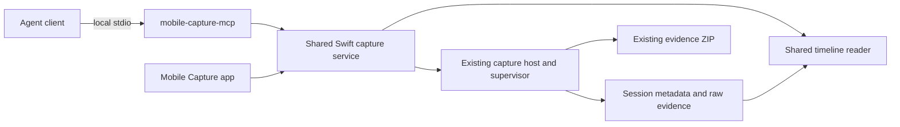

# Mobile Capture MCP plan

Build a local Swift MCP server that lets an agent select a device and app, start
capture, mark reproduction steps, inspect the shared timeline and retrieve the
saved evidence package. The macOS interface and MCP use the same capture services,
scope rules, limits, routing ownership and export format.

This plan adds capture automation and evidence access. Phone taps, app launching
and broader UI automation remain separate integrations; the existing Android MCP
can supply those actions. No company repository, SDK domain list or cloud service
is required. Physical iPhone capture remains an assisted workflow.

## Existing foundation

The repository already supplies:

- A concurrent Swift stdio MCP server, protocol compatibility handling, tool
  catalog, cancellation and app-configured access in `Sources/MCP`.
- `mobile-capture-host` for capture supervision, routing recovery, Stop, safe Save
  cancellation and ZIP publication.
- `NativeCaptureDiscovery` and `CaptureLogDiscovery` for supported devices,
  installed apps, prerequisites and verified logging scope.
- `NativeTimelineStore` for bounded paging, exact search, markers and full details.
- Durable session metadata, worker progress/receipts and save-stage progress.

There are integration gaps: the MCP target currently excludes the capture core,
its environment is Android-specific, tool results support text/images only, and
the capture client/request types are private to `CaptureStore`. Start can wait
100 seconds and Stop up to 900 seconds. The capture window holds one local store
and does not automatically discover sessions started by another process.

## Architecture

Ship a dedicated `mobile-capture-mcp` executable alongside the existing helpers
inside the independent `Mobile Capture.app` described in the
[standalone app plan](CAPTURE-STANDALONE-PLAN.md). It must work without Oh My
Android installed. Oh My Android's optional companion integration opens the app
through a versioned handoff; capture control stays in this service/MCP contract.
Reuse the MCP protocol implementation through an injectable catalog, server
identity and service environment. Keep the existing Android MCP compatible.
Capture use must not require an Android SDK when the chosen device is an iPhone
or Simulator.

Extract a Foundation-only capture service, typed request/result models and host
client from the UI. Keep collectors and routing changes in the existing host;
the MCP process does not launch its own proxy, alter device settings directly
or become the lifetime owner of a recording.

Add a private session/operation registry shared across app and MCP processes.
Resolve opaque session IDs to validated directories under configured capture
roots. Saved captures remain discoverable after the client or app restarts.
Preserve the current single-active-capture routing lease across all callers.

## Proposed tools

Names below are the initial contract, to be finalized with output schemas.

| Tool | Purpose |
| --- | --- |
| `capture_list_devices` | Android, Simulator and physical iPhone availability and capabilities |
| `capture_list_apps` | Installed app identities and executable-resolution requirements for an explicit device |
| `capture_preflight` | Validate sources, app scope, limits, runtime and routing prerequisites; return a short-lived plan ID and required manual actions |
| `capture_start` | Accept a validated plan and request key; return session/operation IDs promptly |
| `capture_list_sessions` | Page through active/recent saved sessions in registered roots |
| `capture_get_session` | Sources, observed evidence, limits, coverage, sizes, routing state, package availability and required actions |
| `capture_get_operation` | Start/Stop/Save stage, completion, errors and cancellation eligibility |
| `capture_add_marker` | Append an agent-origin note at the current time, with a durable receipt |
| `capture_query_timeline` | Source/time/text filtering and bounded chronological pages, including capture-status events |
| `capture_get_event` | Event metadata, raw reference, network flow links and body descriptors/previews |
| `capture_read_body` | Read a requested request/response body in bounded chunks with explicit encoding, offsets, length and digest |
| `capture_stop` | Restore routing, stop collectors and save through the shared host; return an operation handle |
| `capture_cancel_save` | Cancel the matching save operation only when the existing safe-cancellation gate permits it |
| `capture_get_package` | Return the saved local ZIP descriptor, size, digest and completeness; do not rebuild or upload it |

Every device mutation uses an explicit platform/device ID; every session action
uses an explicit session ID. There is no implicit last-device fallback. Log scope
and the existing byte/record/duration limits remain mandatory when logs are enabled.
Preflight is advisory: Start revalidates device identity, scope and settings before
mutation because the device or app may have changed.

## Reliable operation semantics

Add durable asynchronous submission to the host before exposing mutations over
MCP. Returning an operation ID must mean the request and operation ownership have
been persisted. Detached work in the MCP process alone cannot provide that guarantee.

Start, Stop and marker writes accept a caller-generated request key. Persist the
normalized request hash and resulting operation/session identity. Repeating the
same key returns the same operation or marker; a different payload with that key
is rejected. Cover crashes between evidence append and acknowledgment so a retry
cannot create a duplicate marker or recording. Keep this coordination durable
across multiple MCP server processes, not just within one Swift actor.

Model operations as `accepted`, `running`, `needs_user_action`, `succeeded`,
`failed` or `cancelled`. Return short tool responses and poll operation status;
optional MCP progress notifications improve the experience but are not required
for correctness or client compatibility. Request cancellation stops a read/query
or wait. Once a mutation is durably accepted, cancelling its MCP request does not
undo it or kill its supervisor. Reconnect and resolve the request key/operation ID.

Save cancellation remains an explicit action with the matching operation ID.
Keep routing restoration and verified collector shutdown ahead of cancellation,
and retain the current publication gate and prior-ZIP preservation. A status
timeout does not establish process death or authorize signalling a PID from disk.

Keep operation completion separate from evidence completeness: a successful Save
can produce a partial package. Return stable domain codes such as `capture_busy`,
`setup_required`, `routing_recovery_required` and `stale_cursor`, with actionable
details. Expected manual-action states are structured outcomes; a malformed tool
request is a protocol/input error. Neither absence of decoded requests nor a
successful process launch is proof that traffic or app logs were observed.

Record the initiating client and action origin in session context and marker
details. These are audit context, not authenticated human identity. Agent notes,
companion status and device-emitted evidence remain distinguishable. Timestamp
proximity continues to be inferred; shared identifiers are needed for causality.

## Bounded evidence access

Return typed `structuredContent` with an output schema and a concise text fallback
for compatible clients. Begin with tool-based reads; MCP resources/resource links
can be added for clients that support them without making resources a prerequisite.
The existing `ToolResult` needs structured-result support.

Timeline queries default to 100 previews, with a maximum of 500 and a separate
serialized-response byte budget. Bind cursors to session, generation and filters;
return a specific stale-cursor result after a rebuild. Report indexed counts,
pending bytes and `search_complete` so an unindexed backlog is never described as
zero matching evidence. Expensive exact searches must be cancellable without
blocking marker writes or Stop. Return pending search/operation handles when a
scan cannot finish within a short request budget.

Full bodies stay in the saved evidence. Event reads return descriptors and small
previews; body reads default to 8 KiB and cap each response at 64 KiB. Explicitly
report returned byte ranges, encoding and whether more data exists. Binary bodies
use base64 with an encoded-response budget. Preserve full-file/body integrity
information and identify whether a preview is masked. Avoid splitting a UTF-8
character without indicating byte-based encoding semantics.

Bounded responses alone do not guarantee bounded parsing memory. Implement or
measure deferred/streaming body access for large records instead of loading every
full event/body just to return a preview. Test bodies materially larger than the
response budget. Never silently truncate stored bodies or let UI Clear/Pause
change the agent's complete evidence view.

## App controls and access

Add a Mobile Capture agent connection section with the bundled executable path,
copyable local stdio configuration and read/control access settings. Reuse the
existing access pattern, but do not inherit an unconfigured Full Control default.
Grant capture control once through trusted local configuration; avoid repeated
application approval dialogs for routine actions within that grant. Device trust,
certificate installation and OS authorization remain their existing manual steps.
Tool annotations describe effects; runtime checks enforce access.

Saved-evidence reading and capture control are separate capabilities. Mask
credential headers in default previews; authorized explicit detail/body reads
can return original evidence. Explain at connection setup that data returned to
an agent can reach its model provider, even though capture storage and transport
are local. Do not upload ZIPs automatically or expose tunnel keys, private CA
material, runtime tokens or unrestricted filesystem reads. Treat captured messages
and HTTP payloads as untrusted evidence, never as commands or tool instructions.

The app discovers externally started captures and shows their source/operation
status. A user can attach to the same timeline and stop/save it. Do not silently
replace an unrelated session currently being inspected. Agent actions and manual
actions share the same registry, conflicts and lifecycle rules. Closing a client
connection does not silently remove a recording from the UI.

## Physical iPhone and unattended sessions

Preflight returns explicit manual actions for USB trust/unlock, WireGuard import
and activation, certificate installation/full trust and tunnel-off confirmation.
Do not let an agent fabricate a human tunnel-off acknowledgment. Resume the
operation after a trusted UI confirmation or explicit user-origin confirmation
record tied to that session; network observations alone cannot verify phone VPN state.

Use finite session budgets for agent-created recordings, independently of the
MCP connection. The existing limits bound logs, while network capture currently
has no equivalent end-to-end session deadline. For Android/Simulator, an agent
session deadline can restore routing and stop/save automatically. Handle an agent
disconnect or missed Stop through that durable policy, rather than assuming the
client will always return.

An iPhone deadline must not blindly kill a tunnel server while the phone still
uses it. Before enabling unattended physical-iPhone network capture, prove a
mode that ends evidence admission while retaining working forwarding until the
user turns the tunnel off. Otherwise expose physical-iPhone network control only
as an attended workflow with a visible manual-action state. Do not describe this
as fully autonomous iPhone capture. The existing WireGuard shutdown crash remains
a separate release blocker. Remaining combined-iPhone and helper-process checks
are tracked in the [live logging validation](CAPTURE-LOGGING-VALIDATION.md).

## Implementation checkpoints

1. **Shared service and durable operations.** Extract UI-independent contracts,
   session discovery/registry, asynchronous host submission and request-key
   idempotency. Keep current UI behavior and routing recovery tests passing.
2. **Read-only capture MCP.** Dedicated server target and generic identity;
   device/app/preflight/session tools, bounded timeline/event/body access and
   package descriptors. Add structured results and protocol compatibility tests.
   This provides an early agent-assisted review of existing captures.
3. **Capture control.** Start, markers, Stop/Save, operation polling and safe
   cancellation. Handle multiple clients, retries, disconnects, finite budgets
   and explicit manual-action states. Prove Android/Simulator first; gate physical
   iPhone network support on its attended workflow and shutdown validation.
4. **App and distribution integration.** Shared capture visibility, human takeover,
   connection/access UI, setup examples, bundled binary and signing/smoke checks.
5. **End-to-end proof.** Synthetic protocol/permission/timeout/retry tests first,
   then the deferred Android, Simulator and physical-iPhone checks. Use the same
   session IDs, timeline and ZIP to compare UI and MCP results.

Parallel implementation can assign the shared host/registry to one agent, the
MCP adapter and schemas to another, and UI/install integration to a third after
the contracts are fixed. The lead owns contract review, integration and checkpoint
commits. Keep routing and lifecycle mutation under one owner.

## Acceptance checks

- Agent starts capture on an explicit device/app, adds a nonce marker, queries
  emitted logs and network events, reads exact request/response bodies, stops and
  gets the same validated ZIP the app displays.
- Repeated Start/Stop/marker requests, including a crash after write but before
  receipt, do not duplicate operations. Conflicting active captures remain blocked.
- Slow start, search and save work survives MCP timeout/reconnection through
  operation IDs. Cancelled queries stop promptly; accepted saves cancel only at
  permitted stages and preserve original evidence and a prior ZIP.
- Read-only mode cannot start capture or change routing. Arbitrary file paths and
  secret runtime artifacts are unavailable through tools/resources.
- Large log/body fixtures keep tool responses bounded, expose indexing/search
  incompleteness, preserve full stored evidence and retain usable marker latency.
- User and agent can inspect the same session. Manual takeover, app close,
  client exit, server restart and orphan recovery have explicit tested outcomes.
- iPhone user-action requirements remain truthful, and abnormal collector exits
  remain visible in operation results and package completeness.

## References

- Existing protocol and tools: `Sources/MCP/Server/MCPServer.swift`,
  `Sources/MCP/Tools/Tool.swift`, `Sources/MCP/Tools/ToolEnvironment.swift`.
- Capture integration: `Sources/State/CaptureStore.swift`,
  `Sources/Core/CaptureLifecycle/NativeCaptureHost.swift` and
  [native runtime](CAPTURE-NATIVE-RUNTIME.md).
- [MCP tool results and structured content](https://modelcontextprotocol.io/specification/2026-07-28/server/tools).
- [MCP cancellation](https://modelcontextprotocol.io/specification/2026-07-28/basic/patterns/cancellation)
  and [progress](https://modelcontextprotocol.io/specification/2026-07-28/basic/patterns/progress).
- [Logging implementation and deferred checks](CAPTURE-LOGGING-PLAN.md).
- [Standalone application ownership and optional launcher](CAPTURE-STANDALONE-PLAN.md).
