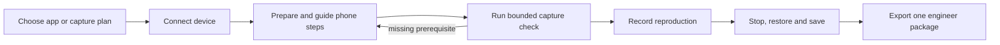

# Guided setup and engineer handoff plan

Provide one **Set Up Capture** entry point that gets a nontechnical user from a
fresh installation to a useful, verified recording. The app handles its tools,
device detection, configuration, checks and evidence packaging. It gives one
concrete instruction at a time for phone actions that require the user.

The repeat workflow should be **connect → choose the capture task → record →
reproduce → Stop & Save → export for the engineer**. Setup is remembered and
rechecked, with only changed or missing steps shown again. Opening saved evidence
never requires completing device setup.

This is a proposed feature, not an implemented setup wizard. It builds on the
[standalone app](CAPTURE-STANDALONE-PLAN.md), shared capture services and
[MCP plan](CAPTURE-MCP-PLAN.md). It does not add another capture owner or change
the evidence/coverage guarantees verified in the
[logging tests](CAPTURE-LOGGING-VALIDATION.md).

## Feasibility and boundaries

A single guided setup experience is feasible. Completely silent setup on an
unprepared personal phone is not the product promise. Android debugging
authorization, iPhone computer trust and manually installed certificate trust
have phone-side steps. Apple's manual certificate flow requires full SSL/TLS
trust separately from profile installation. Managed-device deployment is a
possible later workflow, not a prerequisite for generic users.

| Platform | Automate in the Mac app | User action | Engineer responsibility |
| --- | --- | --- | --- |
| Android device | Bundled ADB/proxy, device/app detection, scope resolution, public-CA transfer, proxy/reverse ownership, checks and cleanup | Enable USB debugging, authorize this computer, approve certificate installation when needed | Supply an inspectable build that emits useful logs and trusts the capture CA in its debug configuration |
| Physical iPhone | Detect paired USB device, resolve app executables, prepare stable tunnel/profile/CA, choose a reachable Mac endpoint, USB logs and capture checks | Unlock/trust the Mac; install WireGuard, import its profile, install/fully trust the public CA; turn the capture tunnel on/off for each session | Supply verified helper identities and a suitable test build if pinning, suppressed logs or OS redaction prevents the requested evidence |
| iOS Simulator | Discover booted devices/apps, resolve processes, import the public CA with permission, apply/restore exact Mac service proxy settings | Have Xcode/runtime installed; grant necessary macOS authorization | Prepare/install the test app and identify required helpers |

The current Android package already bundles ADB and the network engine. The
current physical-iPhone path still requires full Xcode discovery plus separately
installed USB utilities. A new screen alone cannot remove those dependencies.
The first engineering spike below must prove a packaged iPhone path without
Xcode/Homebrew before advertising that experience to ordinary Mac users.

Android debug CA trust belongs in the test build's Network Security Configuration;
installing a certificate alone does not make every app trust it. Custom SDK trust
stacks and pinning still need engineering attention. The assistant should identify
this as a build/setup issue and provide a useful report rather than repeatedly
asking AdOps to reinstall the same certificate.

## First-use experience

Use a task-focused assistant inside the app, with Back, progress, retry and a
clear next action. Show platform-specific steps only after choosing a device.
Advanced paths, executable names, ports and record budgets stay in an engineer
disclosure. Screen-reader labels and text/icons convey status independently of
color. Keep the existing main capture workspace available.

1. **Choose what to capture.** Open an engineer-provided capture plan, or select
   an installed app manually. Explain which sources the task requests. Friendly
   app names and a searchable picker replace a long list of package identifiers.
2. **Connect your device.** Detect automatically. For an unauthorized Android,
   show the debugging prompt instruction; for an untrusted/locked iPhone, show
   the corresponding phone instruction. Recheck automatically instead of making
   the user repeatedly press Refresh. Never switch to another connected device.
3. **Prepare this device.** Offer a primary **Prepare Device** action for the
   app-owned operations. Present any remaining phone instruction individually,
   with a short illustration and **Check Again**. Resume at the unresolved step.
4. **Check capture.** Run a short bounded capture check through the same host as
   normal recording. Guide the user to open the selected app and perform the
   small test action. Show exactly which sources were observed and which remain
   unverified. End or recover the check before starting a real recording.
5. **Record the issue.** Show the task's reproduction steps next to Start/Stop.
   Offer a simple **Mark This Moment** action with optional note text. Keep the
   detailed shared timeline available for users who want to inspect it.
6. **Save for the engineer.** Confirm the package is saved, show evidence coverage,
   and offer **Export ZIP…**, **Show in Finder** and **Record Again**. A local
   summary explains remaining gaps; saving a ZIP is not proof that every requested
   source was captured.

Repeat users should normally see a compact readiness check followed by the
recording screen. USB authorization, saved profiles and CA identity can persist;
phone lock state, connectivity and the current iPhone tunnel state need fresh
attention. A remembered checkmark must not substitute for a current observation.

## Engineer-provided capture plans

Introduce a small, versioned data file that an engineer can give AdOps. It makes
the engineer's evidence requirements explicit without hard-coding an organization,
ad provider or SDK into the app. Manual app selection remains supported.

Initial fields:

- Task title, instructions, plan ID/version and optional ticket reference.
- Supported platform, expected app identifier, optional supported build versions
  and verified executable/helper identities.
- Required/optional log and network sources, bounded log policy and suggested
  timeline filters. Applying the plan visibly enables its requested sources;
  it does not silently opt into whole-device logging.
- Reproduction steps and optional expected evidence hints, such as a request
  host or an app-emitted proof token. Host matching is a hint, not proof that
  a request belongs to the selected app or that two events share causality.
- A short engineer note when a prepared build, test account or special in-app
  debug setting is necessary. Secrets are supplied through the app's normal
  sign-in/test workflow, not embedded in this file.

Capture plans are declarative, untrusted input. They cannot contain shell
commands, executable paths to run, arbitrary downloads, private CA/tunnel material,
automatic uploads, or scripts that manipulate the phone. Validate versions,
identifiers, lengths, helper names and policy caps before applying anything.
Show a human-readable summary before a plan changes the proposed capture scope.
Do not re-sign, patch or install an app as an incidental effect of opening a plan.

For Android, the engineer normally distributes a test build configured for
capture through an existing build-distribution process. For iPhone, an engineer
may supply a signed test fixture for end-to-end checks. The tool does not create
developer accounts, fix app signing, recover disabled log statements or remove
SDK certificate pinning.

## Readiness must mean something measurable

Separate these levels in both the UI and the machine-readable results:

| Level | Evidence required |
| --- | --- |
| Mac ready | Compatible signed tools/resources, writable private storage and adequate disk headroom; no unresolved routing owner |
| Device connected | Explicit device identity, required USB access/trust/unlock and selected app installed |
| Routing reachable | A probe from the device reaches the owned proxy/tunnel; a Mac-only request is insufficient |
| Basic HTTPS verified | A fresh synthetic HTTPS exchange is decoded through this capture CA; plain HTTP loading is insufficient |
| Selected-app logs observed | Fresh emitted records match the resolved app scope; collector launch/connection notices are insufficient |
| Task evidence observed | The app's requested traffic/log evidence is present, where the capture plan supplies a verifiable signal |

Use states such as **Checking**, **Action Needed**, **Ready to Try**, **Verified**,
**Unavailable** and **Needs Engineer Help**, with a reason and next action.
**Ready to Try** describes validated prerequisites before reproduction.
**Verified** describes observed evidence, with the source and check time shown.
An idle app with no emitted logs is **Waiting for App Activity**, not a failed
collector and not proof that logs work.

The basic probe should use a built-in synthetic nonce and a documented test
endpoint, carrying no account information or captured app data. Explain its
destination when starting the check. Prefer a small bundled test page/helper over
asking users to type an IP address or diagnostic command. Offer QR/open-link
assistance where appropriate. A Safari/browser probe validates that client only;
it cannot certify every SDK's TLS behavior or the selected app's logging.

For an app-level check, prefer an engineer-prepared neutral action that emits a
known log token and request identifier. Otherwise guide an ordinary app action
and report what is observable. Never infer a trusted certificate switch from
an **I've Done It** click, or a shared ad-request identity from nearby timestamps.

If a requested source is unavailable, explain the gap before recording. A user
may deliberately collect available evidence as a diagnostic, but the package
must retain the original requirement and missing source. Do not quietly turn a
required logs-plus-network task into a successful network-only verification.

## Device setup details

### Android

Reuse bundled ADB and the tested native UID capability/scope resolution. Transfer
only the public certificate when device trust is needed, then guide the phone's
installation confirmation. Check the actual debug build's HTTPS behavior; some
engineer-prepared builds can already trust the exact embedded debug CA.
Offer a concise engineer checklist for a failed build trust check.

USB routing stays automatic during a capture/check and uses the existing journal
and reverse-mapping cleanup. Do not reset all ADB connections, clear device logs,
change unrelated proxies or broadly reset networking as an automatic repair.
Handle OEM differences and unsupported capabilities with specific guidance.

### Physical iPhone

Keep the existing stable private tunnel profile and CA. Show the current public
CA fingerprint/short identity so a previous unrelated certificate named
mitmproxy is less confusing. Verify the certificate actually used by the probe;
do not rotate an existing CA or discard another app's certificates during setup.

Prepare the profile and select a reachable LAN endpoint automatically when there
is one clear choice. With several networks, explain the choices and verify device
reachability. Reusing a profile after the Mac's address changes may need reimport;
do not claim same-Wi-Fi connectivity proves the tunnel works. Guest-network
isolation, another VPN, blocked UDP and a firewall require actionable diagnostics.
The app must not disable the firewall or another VPN automatically.

WireGuard import, certificate installation/full trust and tunnel activation remain
guided phone actions in v1. A local setup page can serve the public certificate
and synthetic check only; it must not expose private profiles, keys, evidence or
filesystem browsing. Limit its lifetime and validate its fresh check token.
Keep the private WireGuard QR/profile on the explicit import path.

On Stop, explain **Turn Off the Capture Tunnel on Your iPhone**, then use the
existing session-bound confirmation and safe save path. If USB disconnects, device
logs can stop while network forwarding still needs attention. Closing setup,
cancelling a check or expiring a timer must not kill forwarding while the phone
still depends on it. Keep **Restore Connection** available after an interruption.
IPv4 coverage and possible IPv6/proxy/pinning gaps remain visible.

### Simulator

Treat Simulator as an advanced/engineer route, so a general AdOps user is not
asked to install Xcode merely because no Simulator was found. Where available,
detect booted devices, import the selected public CA with authorization, and retain
the existing exact service-proxy snapshot/restore behavior. Explain that this
route can include unrelated Mac/Simulator network traffic.

## Remove installation friction at the source

Ship the standalone Mac app and nested engines with Developer ID signatures and
notarization. Gatekeeper workarounds and instructions to install Python,
Homebrew, mitmproxy or Android Studio should not be the normal Android flow.
Keep pinned dependency versions, source provenance, architecture checks and
inside-out signing in the packaging pipeline.

For physical iPhone, evaluate bundling the needed libimobiledevice utilities and
their complete library dependency closure, plus USB discovery/app enumeration
that does not depend on `devicectl`. Upstream provides native iOS-service access,
so this is a credible implementation direction, not a proven clean-Mac result.
Verify pairing, installed executable metadata, clock sampling and bounded USB logs
on supported iOS versions; inventory licenses/notices and test notarization.
Use the Mac's existing USB services rather than installing a replacement daemon
as an incidental setup step.

Until this succeeds, label the existing iPhone path as engineer-assisted and show
the exact missing prerequisites. Do not advertise **No developer tools needed**
for iPhone because it happens to work on this development Mac. Simulator retains
its Xcode requirement. Signing identities and update-feed configuration also
remain release-owner responsibilities.

## Shared implementation and engineer package

Add a UI-independent setup/readiness service beside discovery and scope services.
Typed results carry check ID, state, device/app/configuration identity, evidence
basis, checked time, explanatory code and supported next actions. Keep inspection
read-only; an explicit preparation/check action invokes the existing host for
mutations. Serialize it with normal captures through the same routing lease.

Bind cached results to device, OS/app build, capture-plan version, engine version,
CA fingerprint and relevant network configuration. Invalidate affected checks on
updates, trust resets, CA changes or endpoint changes. Resume completed setup
where still valid, rather than replaying every action. Avoid a permanent daemon
or a separate proxy implementation for onboarding.

The app and future MCP preflight consume the same results. The agent cannot
assert phone confirmations or promote an unobserved source to verified.
The setup UI reports cancellation/recovery using the existing lifecycle stages.

Extend portable context with the plan ID/version, requested evidence, sanitized
setup-check results and observed gaps. The same shared timeline and ZIP contain
the recording, user markers and companion status. Add a concise engineer summary
of app/build/OS, reproduction steps, source coverage, limits and diagnostics.
Keep body access and all admitted raw evidence intact. A separate setup-only
diagnostic export can help an engineer when capture never starts.

Neither export contains private keys, tunnel profiles, pairing secrets, runtime
control tokens, broad environment dumps or arbitrary files. Explain that a
recording may contain sensitive app/phone activity and offer review before
sharing. Export is local; sending to engineers or an AI service remains an
explicit user action through their chosen workflow.

## Implementation checkpoints

1. **Readiness model and dependency spike.** Inventory existing checks, define
   truthful typed states, and prove the candidate packaged/no-Xcode iPhone path
   on a clean Mac. Track supported OS/architecture combinations explicitly.
2. **Guided Android setup.** Add the task-focused assistant, automatic connection
   status, public-CA assistance, bounded check session and recoverable failures.
   Reuse the standalone service boundaries and current Android capture engine.
3. **Guided iPhone setup.** Add one-step-at-a-time USB/tunnel/certificate guidance,
   current-CA identity, device-origin probes and interruption recovery. Gate an
   AdOps release on the known WireGuard shutdown crash and combined capture proof.
4. **Engineer capture plans and evidence requirements.** Implement versioned
   import/validation, friendly task/app selection, reproduction steps and explicit
   partial outcomes. Retain the manual generic route and advanced configuration.
5. **Engineer handoff and repeat-use polish.** Add portable setup diagnostics,
   coverage summary, saved confirmation/export actions, selective rechecks and
   help/recovery entry points. Expose the same readiness model through MCP later.
6. **Fresh-user acceptance.** Test the shipping package and device steps with
   nontechnical participants, including first setup, repeat capture and recovery.

Commit each implemented checkpoint with focused validation.

## Acceptance and product measures

- A supported fresh Android Mac completes setup and export with no terminal,
  Homebrew, developer IDE or engineer interpreting runtime paths.
- A supported physical-iPhone Mac meets the same host-installation goal only
  after the packaged USB/discovery spike passes; phone trust/install/tunnel steps
  remain clear and completable without technical terms to interpret.
- Repeat capture skips valid one-time steps, detects a changed app/CA/endpoint,
  and preserves existing sessions/profiles/certificate identity.
- An installed-but-untrusted iPhone CA, the wrong old CA, an unauthorized Android,
  blocked tunnel traffic, an unsupported/pinned app and zero emitted logs each
  produce distinct, truthful guidance.
- Cancelling/disconnecting/sleeping/relaunching during setup or a check retains
  recovery ownership and never leaves an unnoticed dead proxy/tunnel path.
- A missing required source remains visible in the UI, timeline and engineer
  report. Successful saving does not upgrade evidence completeness.
- Keyboard and VoiceOver users can complete the flow; optional help is available
  later and existing saved sessions stay accessible without onboarding.
- Engineers receive the expected scope, reproduction context and evidence in one
  usable ZIP. Setup diagnostics expose no private capture credentials.

Measure first-use completion, time to first *useful* exported capture, repeat-use
time, required human support, missing-source rate and connection-recovery success.
Initial goals: repeat use needs no technical help, and first use requires only
the documented phone/OS confirmations. Set time targets from observed usability
tests rather than promising a fixed number of minutes before measuring.

## Design and technical references

- Apple-design skill references: `onboarding.md` › Best practices (teach through
  interactivity and defer nonessential setup); `feedback.md` › Best practices
  (inline status and actionable failures); `progress-indicators.md` › Best
  practices (accurate advancement); `accessibility.md` › Cognitive and Vision
  (simple actions, keyboard/VoiceOver and status beyond color).
- [Android USB debugging and authorization](https://developer.android.com/studio/run/device).
- [Android test-build CA configuration](https://developer.android.com/privacy-and-security/security-config).
- [Apple computer trust](https://support.apple.com/en-us/109054) and
  [manually installed certificate trust](https://support.apple.com/en-us/102390).
- [mitmproxy certificate behavior](https://docs.mitmproxy.org/stable/concepts/certificates/)
  and [WireGuard configuration/limitations](https://docs.mitmproxy.org/stable/concepts/modes/#wireguard).
- [libimobiledevice capabilities](https://libimobiledevice.org/), as a candidate
  for eliminating host developer-tool prerequisites; device compatibility still
  needs proof with the packaged versions.
- [Current distribution prerequisites](CAPTURE-DISTRIBUTION.md),
  [capture lifecycle](CAPTURE-NATIVE-RUNTIME.md) and
  [live logging validation](CAPTURE-LOGGING-VALIDATION.md).
