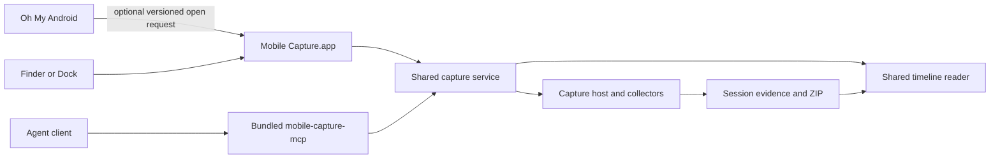

# Standalone Mobile Capture plan

Implementation status and validation are tracked in
[the checkpoint report](CAPTURE-STANDALONE-IMPLEMENTATION.md).

Make Mobile Capture an independent macOS app. It owns device/network capture,
setup, the shared timeline, recovery and evidence exports. Oh My Android keeps an
optional launcher: when Mobile Capture is installed, it can open the app and pass
device/app context. Either product works without the other.

Start with two independently built products in this repository. Moving Mobile
Capture into a separate repository can follow after its dependencies and public
handoff contract are stable; it is not required for independent installation or
releases. This plan changes packaging and ownership, while preserving the existing
capture format and the [planned capture MCP](CAPTURE-MCP-PLAN.md).

## Current coupling

The capture engine is already largely separated, but the shipped app is still
`Oh My Android.app`, including in archives named MobileCapture. Specifically:

- `AppDelegate` creates `CaptureWindowController` and blocks app termination while
  capture stops or needs recovery. The menu and `--capture` flag call this path.
- `CaptureStore` contains private host request/client types as well as UI state.
- `project.yml` embeds the capture host, proxy and `CaptureRuntime` resources in
  Oh My Android. The release script builds that app and signs both capture helpers
  and the existing Android MCP.
- Helpers and bundled dependencies resolve relative to the enclosing app bundle.
  That is useful for the split, but every product must resolve its own bundle.
- Evidence, the capture CA and iPhone tunnel profiles already use neutral,
  per-user locations outside the Oh My Android bundle.

The work is therefore a product/lifecycle split with targeted service extraction.
It does not require rewriting the collectors or replacing mitmproxy.

## Product ownership

| Concern | Mobile Capture | Oh My Android |
| --- | --- | --- |
| Capture UI, timeline, markers, Stop/Save and recovery | Owns | Opens the companion |
| Android, Simulator and physical-iPhone capture setup | Owns | May pass selected Android context |
| Host, proxy, runtime resources and capture dependencies | Bundles and updates | No capture-engine dependency after transition |
| Capture sessions, CA and private iPhone profiles | Owns and preserves | Does not read or modify them |
| `mobile-capture-mcp` | Bundles when implemented | Optional external integration |
| Existing Android panel, inspectors, screenshots/video and Android MCP | No dependency | Keeps existing behavior |
| App identity, preferences, updates and release artifact | Independent | Independent |



The two apps communicate through a small public handoff contract. They do not
link each other's application modules, share a live `CaptureStore`, or require
matching application version numbers. MCP is a separate entry point to the same
capture service, not an alternate engine inside Oh My Android.

## Native discovery and invocation

Give Mobile Capture its own stable bundle ID, product name, icon, settings domain
and app entry point. Use an owner-controlled reverse-DNS prefix; the existing
`se.royan` identifiers are not a proposed identity for the new product. Choose
the permanent release identity before publishing. A development build can use a
distinct ID to coexist predictably with the installed release.

Add a small `CaptureAppLauncher` to Oh My Android:

1. Resolve an explicitly selected companion location, or use
   `NSWorkspace.urlForApplication(withBundleIdentifier:)` for the release ID.
   Recheck availability when the user invokes the action; installation state can
   change while Oh My Android is running.
2. Open the resolved app with `NSWorkspace.OpenConfiguration`, using
   `openApplication(at:configuration:)` for a plain launch or
   `open(_:withApplicationAt:configuration:)` for a handoff URL. Activate/reuse the
   existing app instance instead of requesting another instance.
3. Show an actionable launch error if opening fails. A successful launch means
   the app was opened; it does not mean a device was selected or capture started.

Launch Services can resolve an app outside `/Applications`, including after a
rename or move. Its bundle-ID lookup uses heuristics when multiple copies exist.
Provide **Choose App…** for an explicit location and show that selection in
settings. Validate the selected bundle and revalidate a stale selection. Use
explicit application targeting for handoff URLs instead of relying on whichever
app happens to be the default handler for a custom scheme.

No shell command, AppleScript automation grant, privileged daemon or always-on
HTTP listener is needed for this launch-only integration. App discovery and a
bundle ID are not authentication for future capture-control IPC.

## Versioned handoff contract

Register a proposed custom URL scheme, `mobilecapture`, in the standalone app.
Its final name must be checked before release. Receive requests through one
typed, main-actor handoff router on both cold launch and an already running app.

Illustrative requests, not an implemented API:

```text
mobilecapture://open?v=1
mobilecapture://open?v=1&platform=android&device=DEVICE_ID&app=com.example.demo
mobilecapture://session?v=1&id=OPAQUE_SESSION_ID
```

Construct URLs with `URLComponents` and encoded query items, never string
concatenation or shell interpolation. Define supported versions/actions, required
fields, length limits, duplicate-field handling and invalid-input errors. The app
can advertise supported handoff versions in a documented Info.plist metadata key;
Oh My Android reads that before sending optional context. Unsupported context
falls back to plain launch with an explanation. The receiver still validates
every request independently.

Version 1 supports three actions:

- **Open:** reveal the capture workspace.
- **Prefill:** resolve an explicit platform/device ID and optional app identity,
  show the selection, and let the user review sources/scope before Start. Do not
  silently select another device when the requested one is absent or unavailable.
- **Open session:** resolve an opaque ID through the capture registry and inspect
  that session. Reject arbitrary file paths or filesystem operations in URLs.

If a recording is active or the user is inspecting another session, show the
incoming context without replacing that work automatically. Repeated open
requests must not create recordings or duplicate sessions. No request bodies,
credentials, CA material or tunnel profiles belong in URLs.

A public deep link never starts/stops capture, installs certificates, changes
routing or acknowledges an iPhone tunnel-off step. Those operations belong to
the UI and the planned MCP access/control model. If richer integration becomes
necessary later, add authenticated IPC over the same service contracts rather
than extending launch URLs into a second control protocol.

## User experience

In Oh My Android, use **Open Mobile Capture…** when the companion is available.
The existing keyboard shortcut can invoke the launcher. Pass the selected Android
device/app when it is known; invoking the menu without a selected device still
opens the companion normally.

When it is absent, offer **Set Up Mobile Capture…** with **Choose App…** and a
link to the project's eventual installation instructions. Explain that it is an
optional separate app. Do not leave a disabled item with no route to setup or
download/install software automatically. Do not invent a release download URL
before one exists.

Mobile Capture has its own Dock identity, app menu, About, Settings and normal
window reopening. Preserve the current clear Start/Stop actions, save progress,
Capture Saved feedback, timeline controls and Export ZIP/Show in Finder actions.
It must launch without Oh My Android, without an Android SDK for iPhone capture,
and without a connected device just to inspect an existing session.

Quitting Oh My Android has no effect on a Mobile Capture session. Closing the
Mobile Capture window keeps an active recording discoverable through the Dock.
Quitting Mobile Capture runs its own existing stop/recovery policy and explains
remaining manual actions. In particular, a physical-iPhone tunnel must be turned
off before its forwarding service is removed. The MCP unattended-session policy
remains as defined in its plan; a client disconnect is not a Stop command.

## Code and build boundaries

Use explicit source membership in `project.yml`; its current broad `Sources`
inclusion must not accidentally compile two `@main` entry points or link capture
services back into Oh My Android.

- **Capture service/core:** move host client/request models out of `CaptureStore`;
  expose UI-independent discovery, session, timeline and lifecycle APIs. Reuse
  this extraction for MCP. Keep platform routing/collector ownership in the host.
- **Capture UI:** `CaptureStore`, capture views, commands, setup views and window
  controller belong to Mobile Capture. The existing generic `ToolWindow` can be
  shared as a small presentation utility without pulling in `AppModel` or the
  Android panel.
- **Standalone app shell:** add a Mobile Capture target/scheme, dedicated entry
  point/delegate, Info.plist, entitlements, assets and settings. Move capture quit
  handling and menu commands from the original delegate into this shell.
- **Original app integration:** replace its window creation with the launcher;
  forward the existing `--capture` behavior for compatibility. Remove its capture
  commands and embedded capture-only helpers/resources after the new app works.
- **Helpers and MCP:** resolve dependencies from the owning capture bundle,
  including when started from a shell/MCP client with a minimal environment.
  Shared MCP protocol code may be factored into a small neutral module, while
  each server retains its own identity, tool catalog and access settings.

Avoid a large general-purpose framework extraction. Use internal library targets
or a local Swift package only where multiple capture executables need the same
code. Oh My Android needs the handoff schema, not the capture libraries. Keep Swift
6 concurrency checking and warnings-as-errors for both products.

## Existing data and transition

Keep the current locations in the first standalone version:

| Data | Existing per-user location |
| --- | --- |
| Sessions and exports | `~/Library/Application Support/MobileCapture/Sessions` |
| Private iPhone tunnel profiles | `~/Library/Application Support/MobileCapture/IPhoneTunnels` |
| Stable capture CA/private key | `~/Library/Application Support/Capture Companion/mitmproxy` |

Changing the enclosing app must not regenerate the CA or tunnel keys. Keeping
these identities means the product split itself should not require reinstalling
the phone certificate or WireGuard profile. Network address changes, expired
certificates or separately changed profiles can still require setup.

Add the session registry described in the MCP plan so the new app can discover
existing sessions. Keep the existing evidence/package format and check supported
schema versions before any recovery write. Copy only named capture-specific
preferences once where necessary; do not import the original Android MCP's
Full Control default or unrelated screenshot/video settings.

Preserve the existing per-user routing lease across old prototype builds, the
standalone app and MCP. Do not introduce a second lock name or let two products
start competing collectors. Before replacing/removing an old bundle, finish its
active session or complete verified recovery. Some persisted runtime paths refer
to helpers in that old bundle, so keeping evidence alone is not enough to assume
recovery can proceed after deleting it.

Do not move active session directories or rewrite absolute paths in place. If
layout changes become necessary later, perform an offline, journaled migration
with rollback and preserve unknown/newer schemas for inspection. Old capture
builds must not resume writing to a session after its ownership has transferred.
The original screenshot/video capture directory remains independent.

## Distribution and repository independence

Build a real `Mobile Capture.app` artifact with its own version and helpers,
including `mobile-capture-mcp` when implemented. Make dependency bundling and smoke
checks target-aware. Oh My Android releases should no longer contain the capture
runtime, proxy, CA assets or capture MCP after the transition. ADB needed by its
existing Android features remains its own dependency.

Use independent app/update identities, release manifests, signing configuration
and update feeds/keys. Never point the new product at the original project's
updater feed. Updates remain disabled until the owner configures the new feed and
keys. Preserve applicable upstream MIT attribution and bundled dependency notices.
Public distribution needs the standalone bundle and nested engines signed and
notarized; renaming the existing ZIP is insufficient. Maintain the current
Apple-Silicon/macOS-26 support floor until broader support is separately proven.

Keep independent build/release commands and CI smoke jobs even while sharing this
repository. An eventual repository split copies the capture-owned targets,
required neutral utilities, tests, runtime resources, packaging and license
history. The original repository then retains only its optional launcher and
published handoff contract; neither app requires the other's source checkout.

## Implementation checkpoints

1. **Extract the service and define handoff v1.** Inventory source dependencies,
   extract the UI-independent client/models, and document ownership/versioning.
   Preserve the working embedded app. Share this foundation with MCP checkpoint 1;
   standalone launch does not require finishing all MCP durable operations first.
2. **Build the independent app.** Add the standalone target, app lifecycle,
   settings, resources and helpers. Open existing sessions and preserve CA/profile
   identities. Validate independent launch before removing the embedded window.
3. **Integrate the optional launcher.** Implement discovery, explicit launch,
   cold/warm URL handling, context validation and absent/incompatible-app UX.
   Remove capture UI/quit ownership and runtime embedding from Oh My Android.
4. **Prove transition and packaging.** Test old-session discovery, old-owner
   recovery/lease conflicts, selected-app relocation and independent release
   artifacts. Update signing, dependency smoke checks and installation guidance.
5. **Connect the capture MCP and validate both entry points.** Bundle the planned
   server in Mobile Capture, use the same registry/service, and prove manual and
   agent captures appear in the same timeline and ZIP. A separate-repository move
   is optional after these boundaries are established.

Commit each checkpoint with its relevant build/verification results. Keep device
tests coordinated with the user. The existing physical-iPhone WireGuard shutdown
crash and the remaining [logging acceptance checks](CAPTURE-LOGGING-VALIDATION.md)
still gate release; the product split does not resolve them.

## Acceptance checks

- Mobile Capture runs with Oh My Android absent, and vice versa. Quitting either
  app does not terminate work owned by the other.
- The original app opens the installed companion from a nonstandard location,
  handles absent/moved/incompatible copies, and supports an explicit development
  app selection without launching a different copy by accident.
- Plain launch, cold/warm context handoff and reopening a closed capture window
  work. Invalid URLs, unsupported versions and unavailable device/app identities
  produce feedback without routing changes or silent fallback to another device.
- Existing sessions and ZIPs open; CA/public-certificate fingerprints and private
  tunnel profiles are unchanged. Legacy routing recovery and the shared lease
  prevent old/new/MCP owners from competing.
- Android, Simulator and physical-iPhone capture retain the same source scope,
  log limits, timeline evidence references, save feedback and package contents.
- Each distributable contains only its required helpers and passes signature,
  dependency and launch smoke checks. Capture MCP works without Oh My Android.
- Newly required standalone-app permissions/OS authorization are documented and
  tested rather than assumed to transfer from the original app's identity.

## References

- Apple [application lookup by bundle ID](https://developer.apple.com/documentation/appkit/nsworkspace/urlforapplication(withbundleidentifier:)):
  returns an optional app URL and uses heuristics for multiple matching copies.
- Apple [explicit asynchronous application opening](https://developer.apple.com/documentation/appkit/nsworkspace/open(_:withapplicationat:configuration:completionhandler:)):
  opens URLs using a specified app and reports launch failure.
- Current ownership: `Sources/App/AppDelegate.swift`,
  `Sources/App/OhMyAndroidApp.swift`, `Sources/Windows/CaptureWindowController.swift`,
  `Sources/State/CaptureStore.swift`, `project.yml` and `Scripts/release.sh`.
- [Capture MCP plan](CAPTURE-MCP-PLAN.md),
  [logging plan and deferred proof](CAPTURE-LOGGING-PLAN.md),
  [current distribution](CAPTURE-DISTRIBUTION.md) and
  [native runtime](CAPTURE-NATIVE-RUNTIME.md).
